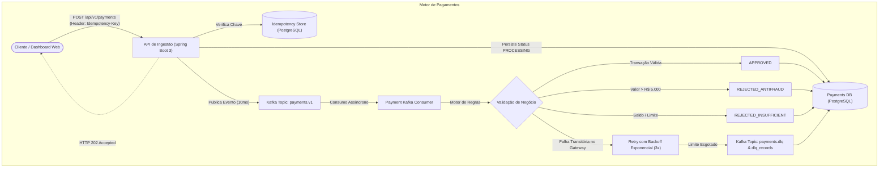

# Event-Driven Payment Engine

Motor de processamento de pagamentos assíncrono de alta performance desenvolvido em **Java 21**, **Spring Boot 3.3**, **Apache Kafka (Redpanda)**, **PostgreSQL** e **Docker**.

Projetado para cenários de alta concorrência e missão crítica (e-commerces e fintechs), o motor implementa **ingestão assíncrona não bloqueante**, **garantia estrita de idempotência**, **motor de regras antifraude**, **tolerância a falhas com retries exponenciais** e roteamento para **Dead Letter Queue (DLQ)**. Inclui um **Dashboard Interativo** com simulador de carga e gerador de massa de testes em 1 clique.

---

## Arquitetura do Sistema



---

## Principais Recursos e Diferenciais

- **Ingestão Assíncrona Não Bloqueante (`HTTP 202 Accepted`):** A requisição é validada, gravada e despachada para o cluster Kafka em milissegundos, desacoplando o cliente do processamento da adquirente.
- **Controle Rígido de Idempotência:** Utiliza cabeçalho `Idempotency-Key` com índice único no banco de dados. Requisições repetidas retornam instantaneamente a transação original sem duplicar cobranças nem republicar eventos.
- **Resiliência e Dead Letter Queue (DLQ):** Em caso de falhas transitórias (timeouts de gateway), a mensagem é retentada até 3 vezes com intervalo exponencial. Persistindo a falha, o evento é encaminhado para o tópico `payments.dlq` com payload retido para auditoria.
- **Segurança e Privacidade (PCI-DSS & LGPD):** Nenhum dado sensível de cartão é armazenado na íntegra. Números de cartão são mascarados (`**** **** **** 1234`) antes de qualquer persistência ou emissão de logs.
- **Dashboard Web & Gerador de Massa de Testes Embutido:** Interface visual servida pelo próprio back-end com métricas em tempo real (KPIs) e botões de simulação de cenários em 1 clique (Aprovação, Fraude, Saldo Insuficiente, Timeout/DLQ, Idempotência e Rajada Concorrente).
- **Consumo Otimizado de Recursos (< 800 MB RAM):** Utiliza **Redpanda** (implementação de Kafka em C++ sem Zookeeper) e **PostgreSQL Alpine**, permitindo execução leve em qualquer máquina de desenvolvimento.

---

## Tecnologias Utilizadas

- **Linguagem:** Java 21 (Records, Pattern Matching, Virtual Threads Ready)
- **Framework:** Spring Boot 3.3.4 (Spring Data JPA, Spring Kafka, Spring Validation, Actuator)
- **Mensageria:** Apache Kafka / Redpanda (v24.2)
- **Banco de Dados:** PostgreSQL 16 Alpine
- **Documentação da API:** OpenAPI 3 / Swagger UI
- **Containerização:** Docker & Docker Compose (Multi-stage build com usuário não-root)

---

## Como Executar Localmente

### Pré-requisito
- Docker e Docker Compose instalados.

### 1. Clonar o repositório
```bash
git clone https://github.com/luciojr-dev/event-driven-payment-engine.git
cd event-driven-payment-engine
```

### 2. Subir o ecossistema completo
Execute o comando abaixo na raiz do projeto:
```bash
docker compose up -d
```

O Docker Compose irá inicializar automaticamente:
1. `payment_postgres` (PostgreSQL na porta `5432`);
2. `payment_kafka` (Redpanda/Kafka na porta `9092`);
3. `payment_engine` (Aplicação Java 21 Spring Boot na porta `8080`).

---

## Interfaces e Acesso

- **Dashboard & Simulador Interativo:** [http://localhost:8080/](http://localhost:8080/)
- **Documentação Interativa Swagger UI:** [http://localhost:8080/swagger-ui.html](http://localhost:8080/swagger-ui.html)
- **Healthcheck & Métricas do Actuator:** [http://localhost:8080/actuator/health](http://localhost:8080/actuator/health)

---

## Exemplos de Uso da API via cURL

### 1. Submeter Pagamento (Sucesso)
```bash
curl -X POST http://localhost:8080/api/v1/payments \
  -H "Content-Type: application/json" \
  -H "Idempotency-Key: pay_req_1001" \
  -d '{
    "customer_id": "cust_12345",
    "amount": 189.90,
    "currency": "BRL",
    "payment_method": "CREDIT_CARD",
    "card": {
      "holder_name": "LUCIO JUNIOR",
      "cardNumber": "4532117890123456",
      "expirationDate": "12/28",
      "cvv": "888"
    }
  }'
```
*Retorno (HTTP 202 Accepted):*
```json
{
  "paymentId": "pay_a1b2c3d4e5f60718",
  "status": "PROCESSING",
  "amount": 189.90,
  "currency": "BRL",
  "maskedCard": "**** **** **** 3456",
  "message": "Pagamento aceito e enfileirado para processamento assíncrono via Kafka."
}
```

### 2. Consultar Status do Pagamento
```bash
curl http://localhost:8080/api/v1/payments/pay_a1b2c3d4e5f60718
```
*Retorno após o processamento da fila:*
```json
{
  "paymentId": "pay_a1b2c3d4e5f60718",
  "status": "APPROVED",
  "statusReason": "Transação autorizada com sucesso pela adquirente.",
  "retryCount": 0
}
```

### 3. Testar Cenário de Timeout e Dead Letter Queue (DLQ)
Valores com `999.99` acionam o teste de instabilidade transitória:
```bash
curl -X POST http://localhost:8080/api/v1/payments/simulate/preset/timeout-dlq
```
*A aplicação tentará o processamento 3 vezes e, em seguida, encaminhará o evento para o tópico `payments.dlq` com status `FAILED_SENT_TO_DLQ`.*

---

## Testes Automatizados

Para rodar a suíte de testes unitários:
```bash
mvn test
```

---

## Autor

**Lucio Junior**  
Desenvolvedor Back-end (Java & Python) | AI Engineering & Sistemas Multi-Agentes  
LinkedIn: [linkedin.com/in/lucio-dev](https://linkedin.com/in/lucio-dev)  
E-mail: [luciojr2110@gmail.com](mailto:luciojr2110@gmail.com)
